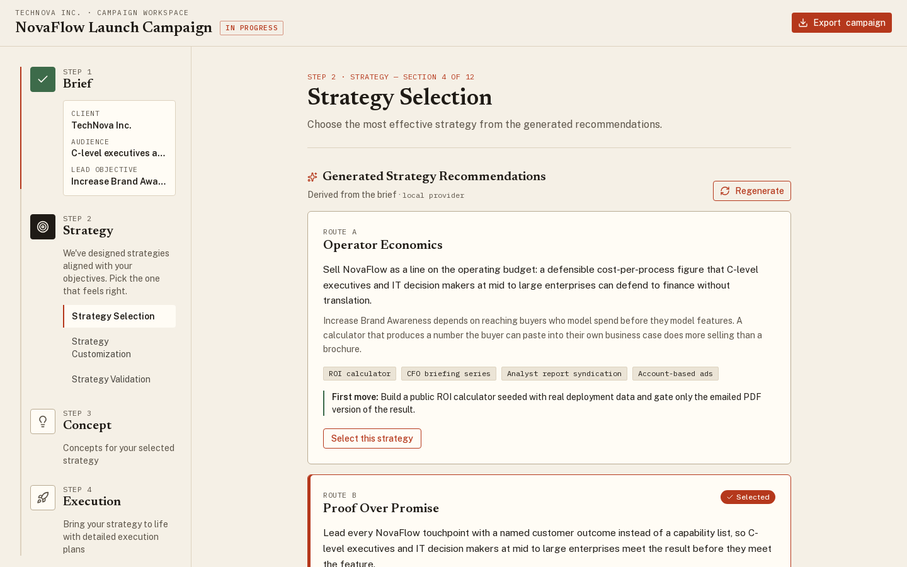
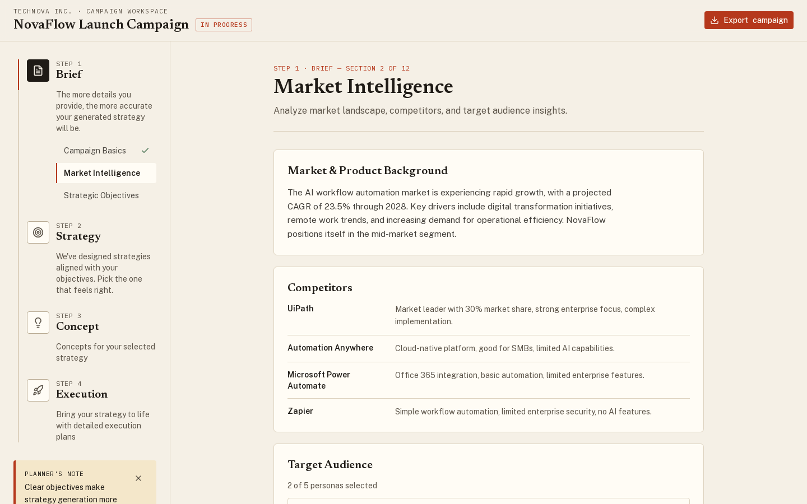
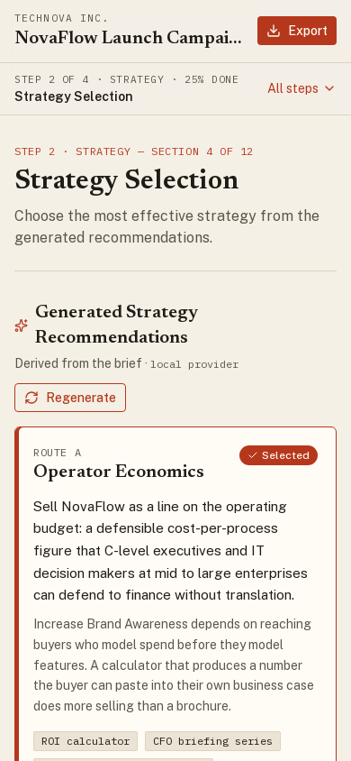
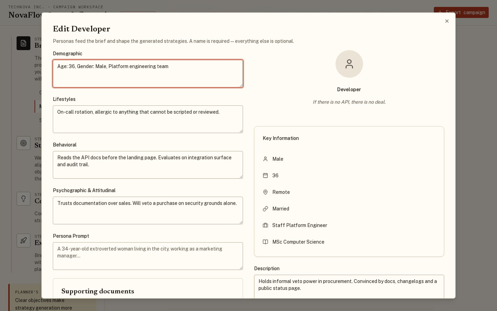
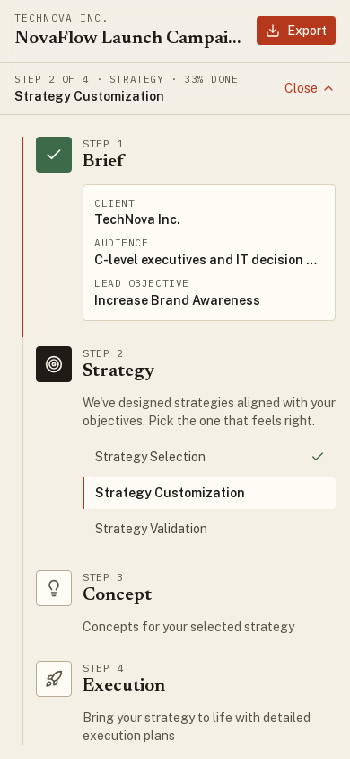
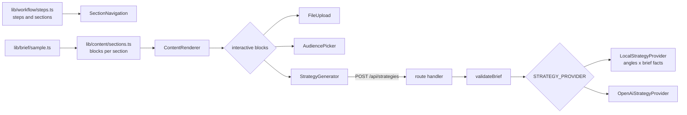

# Campaign Strategy Workspace

A single-page Next.js app for planning a marketing campaign. It takes a campaign brief and walks a planner through four steps (Brief, Strategy, Concept, Execution). In the Strategy step, a generator turns the brief into strategy recommendations the planner can choose from. It was built as a take-home exercise and runs fully offline by default. No API key is needed.



## What it does

- **12 sections across 4 steps**, all defined in `lib/workflow/steps.ts`. The current section lives in the URL (`?section=strategy-selection`), so reloads and shared links land in the same place. Back and Next mark sections complete, and the sidebar tracks progress.
- **Strategy recommendations** come from `POST /api/strategies`. By default, a local, deterministic generator writes them by combining seven planning angles with facts from the brief. The same brief always gives the same routes, and each one has a positioning line, a rationale, channels and a concrete first move.
- **Optional hosted model**: any OpenAI-compatible `/chat/completions` endpoint can be used instead, through environment variables. The key is read only on the server.
- **Audience personas**: five seeded personas can be ticked, edited or deleted, and new ones can be created.
- **Attachments** for the brief and for each persona: `.pdf`, `.xlsx`, `.docx`, `.doc`, up to 5 MB each and 10 per list. Only metadata is kept; the files are never read or uploaded.
- **Export campaign** downloads the brief, chosen audiences, chosen strategy, attachment list and completed sections as one JSON file.

| Desktop | Phone |
| --- | --- |
|  |  |
|  |  |

## Running it

### Docker (one command)

```bash
docker compose up --build
```

Open http://localhost:3000. The image is a multi-stage Node 22 build that serves Next.js's standalone output as the unprivileged `node` user. The container uses a read-only filesystem and has a health check on `/api/health`. No `.env` file is needed.

### Node

You need Node 22 (see `.nvmrc`).

```bash
npm ci
npm run dev        # http://localhost:3000
```

For a production build, run `npm run build && npm start`. The build downloads the three Google Fonts once through `next/font`, so it needs network access the first time.

### Using a hosted model

Copy `.env.example` to `.env.local` (or export the variables before running `docker compose up`), then set:

```
STRATEGY_PROVIDER=openai
STRATEGY_API_KEY=...
STRATEGY_MODEL=gpt-4o-mini
STRATEGY_BASE_URL=https://api.openai.com/v1
STRATEGY_TIMEOUT_MS=20000
```

If `openai` is set without a key, the app falls back to the local generator instead of failing. `GET /api/health` reports which provider is active.

## API

Both routes are dynamic route handlers in `app/api/`. The examples below were captured from the Docker build running the local provider.

`GET /api/health`

```json
{ "status": "ok", "strategyProvider": "local", "sections": 12 }
```

`POST /api/strategies` takes `{ "brief": {...}, "count": n }`. `client`, `product` and `audience` are required. Text fields are capped at 4,000 characters, and `count` is clamped to 1 to 5 (default 3).

```bash
curl -s -X POST http://localhost:3000/api/strategies \
  -H 'content-type: application/json' \
  -d '{"brief":{"client":"TechNova Inc.","product":"NovaFlow","audience":"IT decision makers"},"count":2}'
```

```json
{
  "provider": "local",
  "strategies": [
    {
      "id": "category-redefinition",
      "title": "Category Redefinition",
      "positioning": "Stop competing inside the automation category the category leader defined and name the problem NovaFlow actually solves, so the comparison set is rewritten in TechNova Inc.'s favour.",
      "rationale": "Feature-for-feature comparison against the category leader is a fight on their terms. Publishing original research gives IT decision makers a new vocabulary and gives the sales team a reason to make the first call.",
      "channels": ["Owned research report", "Executive podcast tour", "Conference keynote", "Organic social"],
      "firstMove": "Commission a benchmark study of how much working time is lost to manual handoffs, and hold the findings back for an embargoed launch."
    },
    {
      "id": "time-to-value",
      "title": "Time To First Value",
      "positioning": "Make the promise a clock rather than an adjective: show IT decision makers exactly how long it takes to get one workflow live in NovaFlow, and let the trial prove it.",
      "rationale": "Anchoring the campaign to a measured first win moves the argument from \"can it do this\" to \"how fast\", which is the question that closes the headline KPI.",
      "channels": ["Interactive product tour", "Guided trial", "Search", "Lifecycle email"],
      "firstMove": "Instrument the trial to record time-to-first-automation, then build the launch creative around the median figure it reports back."
    }
  ]
}
```

The brief above leaves out competitors and KPIs, so the generator writes "the category leader" and "the headline KPI" where those facts would go. It does not invent them.

The local provider's answers are sent with `cache-control: private, max-age=60`, and hosted-model answers with `no-store`. Errors come back as JSON with a status code:

| Case | Status | Body |
| --- | --- | --- |
| Body is not JSON | 400 | `{"error":"Request body must be JSON."}` |
| Required brief field missing | 400 | `{"error":"The brief is incomplete.","details":["product must be a string","audience must be a string"]}` |
| Model refused or returned nothing | 422 | `{"error":"…","kind":"refused"}` |
| Model endpoint timed out | 504 | `{"error":"…","kind":"timeout"}` |
| Model endpoint failed or returned unusable JSON | 502 | `{"error":"…","kind":"upstream_error" \| "unparseable"}` |

The UI shows a refusal as "The model declined this brief". It treats other failures as retryable errors.

## How it is put together



Design choices worth knowing:

- **Content is data.** Each section is a list of typed blocks (`prose`, `checklist`, `key-values`, …) built from the brief in `lib/content/sections.ts`. `ContentRenderer` maps block kinds to components, and a switch with a `never` check makes a missing case a compile error. All text renders as text, never as HTML.
- **One seam for strategy sources.** `StrategyProvider` has a single `generate` method. The route handler validates the untrusted body, picks a provider from config and maps `StrategyError` kinds to HTTP statuses. Changing providers is a config change.
- **Deterministic by default.** The local provider seeds an FNV-1a hash with the brief, so tests can assert exact output and screenshots can be reproduced.
- **Uploads are judged per file.** The file extension decides the type; the browser's MIME type only counts against a file when it contradicts the extension. One bad file in a drop of ten doesn't reject the other nine, and every rejection comes with a reason.
- **Look.** The UI is styled as a planner's brief sheet. It uses warm paper and ink colors, with a vermilion accent for actions and moss green for finished work. Headings use Newsreader, body text uses Public Sans, and figures and labels use IBM Plex Mono. All colors are tokens in `app/globals.css`. Below the `lg` breakpoint, the sidebar collapses into a step bar under the header.
- **Accessibility.** The page has a skip link and visible focus rings. The audience list is a real checkbox list, not a menu, so it works from the keyboard. Back and Next move focus to the new section heading.

## Tests and checks

```bash
npm test           # Vitest + jsdom, 13 files / 100 tests, no network needed
npm run typecheck
npm run lint
```

The suite covers workflow navigation, brief validation, upload rules, both strategy providers (with the hosted one mocked at `fetch`), the API route, the export and the main components: the app shell, file upload, audience picker, persona dialog and strategy generator.

## Limitations

- The brief is a fixed sample in `lib/brief/sample.ts`. There's no UI to edit it.
- Nothing is saved. Personas, selections and attachments are lost on reload. Use Export to keep them.
- Concept and Execution are mostly guidance and checklists generated from the brief, not generated creative work.
- The API routes have no authentication. Don't expose an instance publicly with a hosted provider configured.

## License

MIT. See [LICENSE](LICENSE).
