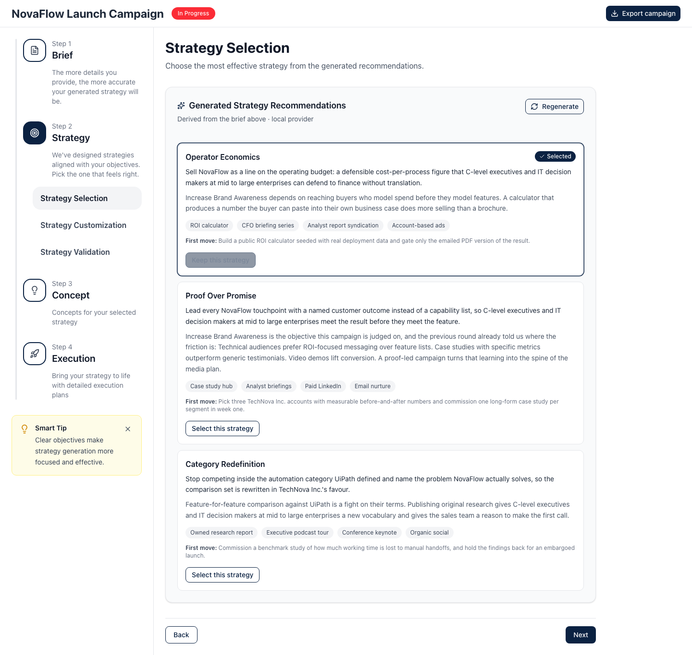

# Campaign Strategy Workspace

A single-page Next.js app for planning a marketing campaign. It takes a campaign brief and walks through four steps (Brief, Strategy, Concept, Execution), with a generator that produces strategy recommendations from the brief. Built as a take-home exercise.



## What it does

- 12 sections across 4 steps, defined in `lib/workflow/steps.ts`. The current section is kept in the URL (`?section=...`) so reloads and shared links work.
- Strategy recommendations from `POST /api/strategies`. By default they come from a local, deterministic generator (no API key needed). The same brief always gives the same three strategies.
- Optional switch to an OpenAI-compatible model through environment variables.
- File attachments (`.pdf`, `.xlsx`, `.docx`, `.doc`, up to 5 MB each, 10 files max). Only metadata is kept; the files themselves are never read.
- Editable audience personas, with five defaults in `lib/personas/defaults.ts`.
- "Export campaign" downloads the brief, selections and attachments list as JSON.

Stack: Next.js 16 (App Router), React 19, TypeScript, Tailwind CSS 4, shadcn/ui, Vitest.

## Getting started

```bash
npm install
npm run dev
```

Open http://localhost:3000. No `.env` file is needed for the default setup.

To use a hosted model, copy `.env.example` to `.env.local` and set:

```
STRATEGY_PROVIDER=openai
STRATEGY_API_KEY=...
STRATEGY_MODEL=gpt-4o-mini
STRATEGY_BASE_URL=https://api.openai.com/v1
STRATEGY_TIMEOUT_MS=20000
```

If `openai` is set without a key, the app falls back to the local generator. The key is only read on the server.

## API

`POST /api/strategies` takes `{ "brief": {...}, "count": 3 }`. `client`, `product` and `audience` are required, and `count` is clamped to 1 to 5.

```bash
curl -s -X POST http://localhost:3000/api/strategies \
  -H 'content-type: application/json' \
  -d '{"brief":{"client":"TechNova Inc.","product":"NovaFlow","audience":"IT decision makers"},"count":3}'
```

`GET /api/health` returns the status and which provider is active.

## Tests and checks

```bash
npm test
npm run typecheck
npm run lint
```

Tests use Vitest with jsdom and cover the workflow navigation, upload validation, both strategy providers, brief validation, the API routes and the main components. They don't need network access.

## Docker

```bash
docker compose up --build
```

This builds a standalone Next.js image and serves it on port 3000.

## Limitations

- The brief is a fixed sample in `lib/brief/sample.ts`; there's no UI to edit it.
- Nothing is persisted. Personas and attachments are lost on reload.
- The Concept and Execution steps are mostly static content generated from the brief.
- There's no auth on the API routes, so don't expose it publicly with a hosted provider configured.
